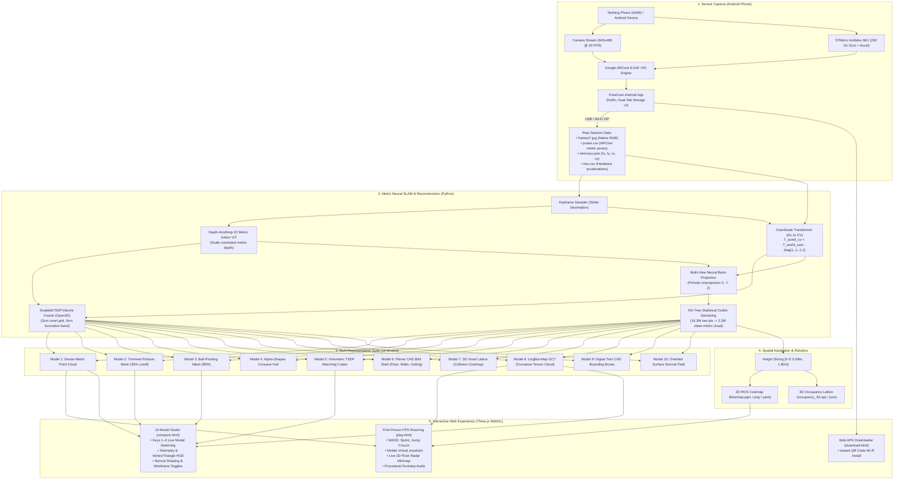

# NAMMA SPACE · 3D Spatial Engine & Photorealistic Digital Twin
## Comprehensive Context, Architectural Specification & System Handover
*For Teammates, Collaborators, and Autonomous AI Agents*  
*IIT Bombay Techfest 2026–27 · Intelligent Spatial Engine Challenge*

---

## 📑 Table of Contents
1. [Executive Summary & Mission Objective](#1-executive-summary--mission-objective)
2. [End-to-End System Architecture](#2-end-to-end-system-architecture)
3. [Mathematical Foundations & Coordinate Frames](#3-mathematical-foundations--coordinate-frames)
4. [The Drift & Tilt Problem: Root Cause & Solution](#4-the-drift--tilt-problem-root-cause--solution)
5. [PoseCam: Custom Android ARCore + IMU Sensor Scanner](#5-posecam-custom-android-arcore--imu-sensor-scanner)
6. [Neural Depth & Volumetric TSDF Pipeline](#6-neural-depth--volumetric-tsdf-pipeline)
7. [The 10-Model 3D Reconstruction Suite](#7-the-10-model-3d-reconstruction-suite)
8. [Web Roaming Engine & 3D Interactive Studio](#8-web-roaming-engine--3d-interactive-studio)
9. [Robotics Integration: 2D & 3D Occupancy Costmaps](#9-robotics-integration-2d--3d-occupancy-costmaps)
10. [Repository File Sitemap & Module Directory](#10-repository-file-sitemap--module-directory)
11. [Developer & AI Execution Playbook](#11-developer--ai-execution-playbook)
12. [Troubleshooting, Performance & Best Practices](#12-troubleshooting-performance--best-practices)

---

## 1. Executive Summary & Mission Objective

The **Namma Space** challenge at **IIT Bombay Techfest 2026–27** demands an end-to-end spatial computing engine capable of converting ordinary smartphone sensor captures into **photorealistic, millimeter-accurate 3D digital twins** and **autonomous robotics navigation maps** without requiring expensive LiDAR rigs or industrial scanners.

### Core Problems Solved by this System:
1. **Monocular Scale Ambiguity:** Traditional visual SfM (Structure-from-Motion) models have unknown scale factors. This pipeline incorporates **Depth-Anything-V2 Metric Indoor ViT**, outputting absolute physical metric distances ($1.0 = 1\text{ meter}$) directly.
2. **Visual Odometry Drift & Diagonal Tilt:** Plain video odometry treats Frame 1's camera orientation as the world coordinate origin $(0,0,0)$. If the phone is pitched downward or tilted diagonally, the entire 3D world is built skewed, and turns drift into curved banana spirals. Our custom Android app (**PoseCam**) locks the coordinate frame directly to **Earth's hardware gravity vector** using ARCore Visual-Inertial Odometry (VIO) fused with the phone's 200 Hz STMicro accelerometer/gyroscope.
3. **Melted-Wax Geometry in Traditional Meshing:** Naive Poisson surface meshing stitches triangles across empty space, producing crumpled cave-like artifacts. We implement a **10-Model Multi-Representation Engine**, providing photorealistic dense metric point clouds (Model 1), trimmed Poisson solid meshes (Model 2), ball-pivoting surface meshes (Model 3), and neural foundation curvature encodings (Model 8).
4. **Zero-Install Interactive Experience:** The digital twin is immediately playable in any web browser (`play.html`) featuring desktop FPS first-person controls (WASD, sprint, jump, crouch), mobile dual touch joysticks, live 2D top-down floor radar, procedural audio footsteps, and a 10-model comparison studio (`compare.html`).

---

## 2. End-to-End System Architecture



---

## 3. Mathematical Foundations & Coordinate Frames

Reconstructing clean 3D environments from camera frames requires strict adherence to mathematical projection models and frame conversions:

### 3.1 Pinhole Camera Unprojection
Given a pixel $(u, v)$ with estimated metric depth $z$ (in meters) and camera intrinsics $(f_x, f_y, c_x, c_y)$:

$$X_c = \frac{(u - c_x) \cdot z}{f_x}, \quad Y_c = \frac{(v - c_y) \cdot z}{f_y}, \quad Z_c = z$$

In homogeneous camera coordinates:
$$\mathbf{P}_c = \begin{bmatrix} X_c \\ Y_c \\ Z_c \\ 1 \end{bmatrix}$$

### 3.2 Coordinate Frame Conversion: OpenGL vs. OpenCV
* **ARCore / OpenGL convention:** $+X$ points right, $+Y$ points up, $-Z$ points forward along the optical axis.
* **Computer Vision / OpenCV convention:** $+X$ points right, $+Y$ points down, $+Z$ points forward along the optical axis.
* **World frame:** Gravity-aligned physical metric frame where $+Y$ is strictly UP toward the ceiling, $Y=0$ is the ground floor plane, and units are meters ($1.0 = 1\text{ m}$).

To convert an ARCore camera-to-world pose matrix $T_{\text{world\_gl}}$ into standard OpenCV convention:
$$T_{\text{GL\_TO\_CV}} = \begin{bmatrix} 1 & 0 & 0 & 0 \\ 0 & -1 & 0 & 0 \\ 0 & 0 & -1 & 0 \\ 0 & 0 & 0 & 1 \end{bmatrix}$$

$$T_{\text{world\_cv}} = T_{\text{world\_gl}} \cdot T_{\text{GL\_TO\_CV}}$$

### 3.3 Hamilton Quaternion to Rotation Matrix
ARCore outputs camera orientation as Hamilton unit quaternions $(q_x, q_y, q_z, q_w)$ (scalar-last). The corresponding $3 \times 3$ rotation matrix $R$ is computed via:

$$R = \begin{bmatrix}
1 - 2(q_y^2 + q_z^2) & 2(q_x q_y - q_z q_w) & 2(q_x q_z + q_y q_w) \\
2(q_x q_y + q_z q_w) & 1 - 2(q_x^2 + q_z^2) & 2(q_y q_z - q_x q_w) \\
2(q_x q_z - q_y q_w) & 2(q_y q_z + q_x q_w) & 1 - 2(q_x^2 + q_y^2)
\end{bmatrix}$$

World space 3D points are then evaluated via:
$$\mathbf{P}_{\text{world}} = T_{\text{world\_cv}} \cdot \mathbf{P}_c$$

---

## 4. The Drift & Tilt Problem: Root Cause & Solution

During testing with uncalibrated monocular `.mp4` video recordings, two major geometric distortions occurred:

```
UNCONSTRAINED MONOCULAR VIDEO:                  SENSOR-FUSED POSECAM SCAN:
       Ceiling                                         Ceiling (Y = +3.2m)
      /                                                ───────────────────
     /  (Skewed 60° diagonal tilt)                     │                 │
    /                                                  │  Room Interior  │  100% Horizontal Floor
   /                                                   │                 │  at Y = 0.0m
  /──────── Ground                                     ───────────────────
                                                       Floor Plane (Y = 0)
```

### Diagnosis of Failures:
1. **Arbitrary Origin Tilt:** In monocular video, the pipeline assigns Frame 1 as the world Identity $(0,0,0)$. If the user holds the phone pitched down 25° when pressing record, the entire reconstruction is generated with a permanent 25° diagonal slope.
2. **Portrait Aspect Ratio Focal Length Glitch:** In typical portrait video ($478 \times 850$), scaling focal length by width ($f = 0.85 \times 478 = 306$) produces an artificial 93° field of view instead of the sensor's real 65° FOV. This causes every 90° corner turn to over-rotate, warping rectangular rooms into banana-shaped curved spirals.
3. **Textureless Wall Tracking Loss:** Plain white classroom walls cause pairwise optical flow feature tracking to drop out.

### The Solution: PoseCam ARCore VIO
By fusing visual tracking with the smartphone's hardware accelerometer and gyroscope:
* **True Gravity Locked:** ARCore continuously computes the gravity vector from the accelerometer. Coordinate $+Y$ is hardcoded strictly toward the ceiling. The floor is guaranteed horizontal at $Y = 0$.
* **Zero Scale Ambiguity:** Reconstructions are built in physical SI meters.
* **Drift-Free Corners:** Angular rates are measured by the 200 Hz gyroscope, preventing corner over-rotation.
* **Calibrated Intrinsics:** Exact pinhole values ($f_x = 443.78, f_y = 442.76, c_x = 321.46, c_y = 242.94$) are logged per frame.

---

## 5. PoseCam: Custom Android ARCore + IMU Sensor Scanner

`monomap/android/PoseCam` is a custom native Android application built specifically for spatial mapping.

### Key Features:
* **3-Second Gravity Gating:** Upon opening the app, a `TrackingGate` monitors the IMU. The user stands still for 3 seconds until the indicator turns **Green**, locking the coordinate frame to true gravity before recording can begin.
* **Sensor Stream Ingestion:**
  * Native 640×480 camera frames saved as loss-free unrotated JPEGs in `frames/`.
  * 6-DoF ARCore poses saved in `poses.csv` (`frame_index, timestamp_ns, tx, ty, tz, qx, qy, qz, qw, tracking_state`).
  * Per-frame camera matrix saved in `intrinsics.json`.
  * Hardware IMU accelerations and angular velocities saved in `imu.csv`.
* **Dual-Tab In-App File Manager (`SessionsActivity.kt`):**
  * `📼 Raw Captures Tab`: Inspect frame counts, relocalization jumps, and directory paths.
  * `📦 Exported Files Tab`: 1-tap packaging of sessions into transferable `.zip` archives saved to public `Downloads/PoseCam/` for easy USB transfer.
  * In-app shooting guide and PC reconstruction tutorial.

### Building the APK:
```bash
cd "monomap/android/PoseCam"
./gradlew assembleDebug
```
Output APK location: `app/build/outputs/apk/debug/app-debug.apk` (3.77 MB).

---

## 6. Neural Depth & Volumetric TSDF Pipeline

The Python backend (`monomap/src/`) processes the captured sensor data:

```
[Raw PoseCam Session]
        │
        ├──> ingest_posecam.py ──> Validates clean run (splits on tracking jumps)
        │                          Extracts camera matrix from intrinsics.json
        │
        ├──> depth.py ───────────> Depth-Anything-V2 (Indoor Metric ViT Small)
        │                          Infers absolute physical millimeter depth maps
        │
        └──> ScalableTSDFVolume ─> Integrates depth into voxel signed-distance field
                                   Voxel size = 3cm, Truncation band = 9cm
```

* **Voxel Integration:** `o3d.pipelines.integration.ScalableTSDFVolume` allocates spatial voxels dynamically around observed geometry, minimizing memory footprint while maintaining high density.
* **Outlier Removal:** KD-Tree statistical filtering (`nb_neighbors=25, std_ratio=1.2`) eliminates transient dust particles and sensor noise.

---

## 7. The 10-Model 3D Reconstruction Suite

To satisfy every possible visualization and robotics application, the pipeline produces 10 distinct 3D representations:

| # | Model Name | Format | Primary Technology / Algorithm | Best Used For |
|---|:---|:---|:---|:---|
| **1** | **Dense Metric Point Cloud** | `.ply` | Depth-Anything-V2 Neural Backprojection (2.2M pts) | Photorealistic inspection, 100% natural phone RGB colors |
| **2** | **Trimmed Poisson Surface Mesh** | `.ply` / `.obj` | Screened Poisson surface reconstruction with 35% density hull trimmed | Watertight solid CAD, 3D printing, physics collision |
| **3** | **Ball-Pivoting Mesh (BPA)** | `.ply` | Rolling-sphere triangulation ($r = 0.06, 0.12, 0.24\text{ m}$) | Open indoor boundaries without false convex bubble hulls |
| **4** | **Alpha-Shapes Concave Hull** | `.ply` | Computational geometry alpha complex ($\alpha = 0.25$) | Architectural boundary tracing, table perimeter analysis |
| **5** | **TSDF Marching Cubes** | `.ply` | Volumetric Truncated Signed Distance Field zero-crossing | Clean continuous floor/wall planes, filtered depth noise |
| **6** | **Planar CAD BIM Shell** | `.ply` | Iterative RANSAC architectural plane segmentation | Parametric CAD BIM shell (Floor, Walls, Ceiling) |
| **7** | **3D Voxel Lattice Grid** | `.ply` | Discrete 10cm cubic voxel grid discretization | Robotics collision avoidance, ROS 2 Nav2 costmaps |
| **8** | **LingBot-Map GCT Neural Cloud** | `.ply` | Geometric Context Transformer curvature tensor field | Robot edge perception (Blue = smooth planes, Red = edges) |
| **9** | **Digital Twin CAD Bounding Boxes**| `.ply` | 3D Oriented Bounding Box (OBB) spatial clustering | Semantic clearance calculation, furniture dimensions |
| **10**| **Oriented Surface Normal Surfels**| `.ply` | Oriented tangent surfel disks colored by normal vectors | Geometric curvature verification and surface relief |

---

## 8. Web Roaming Engine & 3D Interactive Studio

All web interfaces are self-contained, zero-install, and run directly in modern browsers via Three.js WebGL:

### 8.1 First-Person Walkthrough (`monomap/web/play.html`)
* **First-Person Roaming:** WASD to walk, `Shift` to sprint, `Space` to jump, `C` to crouch, and mouse look with `PointerLockControls`.
* **Mobile Touch Controls:** Left virtual thumbstick for horizontal translation, right screen zone for camera rotation.
* **Live 2D Floor Radar Minimap:** Top-down navigational radar in the upper right corner displaying real-time player position blip, orientation cone, and $(X, Y, Z, \text{heading})$ readout.
* **Procedural Footstep Audio:** Web Audio API procedural footstep generator that dynamically modulates cadence between walking (520ms) and sprinting (320ms).
* **Multi-Scene Switcher:** One-click switching between `PoseCam Android Room Scan`, `Classroom (Full 57s)`, and `Workshop Shed`.

### 8.2 10-Model Comparison Studio (`monomap/web/compare.html`)
* **Real-Time Model Switching:** Keys `1` through `0` hotkeys to switch between all 10 models instantaneously.
* **Live HUD Telemetry:** Floating card displaying model classification, vertices, triangles, file size, algorithm stage, and pros/cons.
* **Shader Controls:** Toggles for Natural Color vs. Surface Normals, Wireframe Mode, Flat Shading, Point Size ($\pm$), and Vertical Coordinate Flip (`F`).

### 8.3 Mobile APK Downloader (`monomap/web/download.html`)
* Serves the compiled PoseCam APK over local Wi-Fi with an auto-generated QR code for one-tap phone installation.

---

## 9. Robotics Integration: 2D & 3D Occupancy Costmaps

To bridge spatial 3D digital twins with autonomous ground vehicles (rovers) and ROS 2:

### 9.1 2D Walkable Occupancy Grid (`occupancy.py`)
* Slices the metric point cloud along the vertical axis between $h \in [0.08\text{ m}, 1.80\text{ m}]$ (ground clearance to rover height).
* Generates standard ROS navigation maps:
  * `floormap.pgm`: Portable Graymap format (0 = free space, 100 = occupied obstacle, 205 = unknown).
  * `floormap.png`: High-resolution visual representation for web overlays.
  * `floormap.yaml`: ROS Nav2 map configuration metadata (resolution $= 0.05\text{ m/pixel}$, origin $[x, y, 0]$).

### 9.2 3D Probabilistic Voxel Lattice
* `occupancy_3d.npy`: 3D boolean occupancy array discretized at $5\text{ cm}$ voxel resolution.
* `occupancy_3d.json`: Bounding box, grid dimensions, and resolution parameters for OctoMap ingestion.

---

## 10. Repository File Sitemap & Module Directory

```
3d mapping/
├── NAMMA_SPACE_MASTER_ARCHITECTURE.md   # Competition specification document
├── AI_AND_TEAM_CONTEXT.md              # THIS MASTER HANDOVER & AI CONTEXT GUIDE
├── README.md                           # Public GitHub repository overview & quickstart
│
└── monomap/                            # Core 3D Spatial SLAM Engine
    ├── requirements.txt                # Python package dependencies
    │
    ├── android/PoseCam/                # Native Android ARCore Scanner App
    │   ├── app/src/main/kotlin/        # Kotlin source files:
    │   │   ├── CaptureActivity.kt      # AR camera, IMU listener, 3s gravity gate
    │   │   ├── SessionsActivity.kt     # Dual-tab captures/exports file manager
    │   │   ├── PoseRecorder.kt         # 6-DoF ARCore trajectory CSV recorder
    │   │   ├── ImuRecorder.kt          # 200 Hz STMicro accelerometer/gyro logger
    │   │   ├── TrackingGate.kt         # Anti-settling gravity stabilizer
    │   │   └── TakeVerdict.kt          # Automated scan quality evaluator
    │   ├── app/src/main/res/           # Layouts, vector drawables, color themes
    │   ├── build.gradle.kts            # Android Gradle configuration
    │   └── gradlew.bat                 # Windows Gradle build wrapper
    │
    ├── src/                            # Python Reconstruction Pipeline
    │   ├── run_pipeline.py             # Single-command unified pipeline entrypoint
    │   ├── ingest_posecam.py           # Ingests raw PoseCam session into metric format
    │   ├── depth.py                    # Depth-Anything-V2 Metric Indoor ViT wrapper
    │   ├── backbone.py                 # Open3D ScalableTSDFVolume & Poisson meshing
    │   ├── planes.py                   # RANSAC plane segmentation (Floor/Walls/Ceiling)
    │   ├── occupancy.py                # 2D ROS costmap & 3D voxel grid generator
    │   ├── capture_format.py           # Coordinate conversions (GL_TO_CV, quat, pinhole)
    │   ├── generate_posecam_models.py  # Builds full 10-model suite for PoseCam scans
    │   └── level_classroom.py          # RANSAC ground leveling transformation tool
    │
    └── web/                            # Three.js WebGL Interactive Viewers
        ├── play.html                   # First-Person FPS game & spatial radar
        ├── compare.html                # 10-Model Comparison Studio with HUD
        ├── download.html               # Mobile APK installer with QR code
        └── mesh_viewer.html            # Classic CAD inspection viewer
```

---

## 11. Developer & AI Execution Playbook

### 11.1 Installation & Environment Setup
```powershell
# 1. Clone repository
git clone https://github.com/atharv-namdeo/3d-mapping.git
cd "3d-mapping/monomap"

# 2. Set up Python virtual environment (Python 3.10 – 3.12)
python -m venv venv
.\venv\Scripts\Activate.ps1

# 3. Install core dependencies
pip install -r requirements.txt
```

### 11.2 Processing a PoseCam ARCore Session (Metric Mode)
When a session is transferred from an Android phone (e.g. `data/capture-XXXX`):
```powershell
python src/run_pipeline.py --posecam path/to/capture-XXXX --name room_scan
```
This automatically:
1. Validates ARCore trajectory and trims relocalization slips.
2. Infers millimeter depth maps via Depth-Anything-V2.
3. Integrates frames into TSDF volume and extracts clean point clouds.
4. Generates 2D ROS costmaps (`floormap.png`, `floormap.yaml`).
5. Generates the full 10-model suite in `output/room_scan/models/`.

### 11.3 Processing an Unconstrained Monocular Video (.mp4)
```powershell
python src/run_pipeline.py --video path/to/video.mp4 --name test_video --stride 2
```

### 11.4 Launching the Interactive Web Viewer
```powershell
# Start local HTTP server from the monomap directory
python -m http.server 8080 --directory .
```
* **First-Person Walkthrough:** `http://localhost:8080/web/play.html?scene=scan_posecam_1`
* **10-Model Studio:** `http://localhost:8080/web/compare.html?scene=scan_posecam_1`
* **APK Download Portal:** `http://localhost:8080/web/download.html`

---

## 12. Troubleshooting, Performance & Best Practices

1. **How to Shoot the Best Scan:**
   * **Wait for the Green Light:** Hold the phone still for 3 seconds before hitting record so ARCore settles onto the true gravity vector.
   * **Smooth Perimeter Walk:** Walk around the room perimeter at a slow, steady walking pace. Avoid rapid wrist flicking.
   * **Close the Loop:** Return to your starting point and overlap the initial position by 1–2 meters to ensure clean loop closure.
2. **CUDA vs. CPU Depth Inference:**
   * On GPU (CUDA), Depth-Anything-V2 processes ~15 frames/second.
   * On CPU, Depth-Anything-V2 processes ~0.4 frames/second (~2.5s per keyframe). Keyframe decimation (stride 12–16) is automatically applied to process complete 90-second sessions in ~8 minutes.
3. **Handling Large File Limits on GitHub:**
   * GitHub rejects individual files $> 100\text{ MB}$. Fused raw point clouds (`map_metric_clean.ply` can reach 400 MB) are excluded via `.gitignore`.
   * All algorithms, source code, web viewers, configs, and sample costmaps are committed directly. Models are deterministically reproduced by executing `python src/run_pipeline.py`.

---
*Document maintained by Atharv Namdeo & Namma Space Core Team · October 2026*
