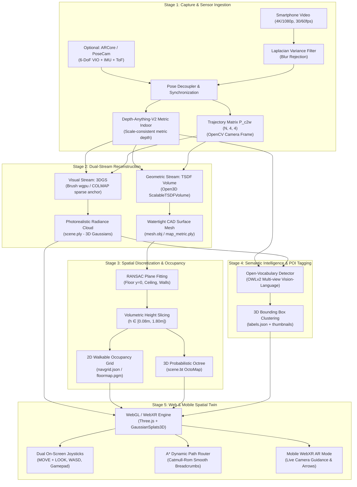
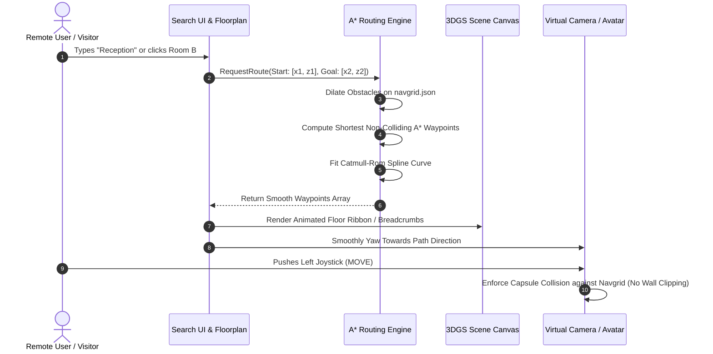

# NAMMA SPACE: Intelligent Spatial Engine & Photorealistic 3D Digital Twin Architecture

**IIT Bombay Techfest 2026–27 · Intelligent Spatial Engine Challenge**  
*Document Version: 1.0 (Master Technical Specification & Living Architecture Document)*

---

## 1. Executive Summary & Competition Objectives

The **Namma Space** challenge asks for an end-to-end spatial computing engine that converts ordinary smartphone captures of physical indoor spaces into **photorealistic, fully interactive 3D digital twins** accessible in a zero-install web interface. The system replaces outdated static 2D blueprints with an interactive spatial navigation platform featuring **first-person 3D roaming**, **open-vocabulary Point of Interest (POI) search**, **non-colliding walkable route calculation**, and **on-site Augmented Reality (AR) camera guidance**.

```
[ Smartphone Capture ] ──> [ Hybrid Visual & Geometric Engine ] ──> [ Zero-Install Web & AR Twin ]
  - Monocular Video          - 3D Gaussian Splats (Visuals)           - Desktop WASD / Mobile Joysticks
  - ARCore / PoseCam IMU     - TSDF Volume Fusion (Planes)            - A* Non-Colliding Navigation
  - Depth-Anything-V2        - 3D OctoMap & 2D Occupancy Grid         - POI Spatial Search & AR Arrow
```

### Evaluation Matrix & Deliverables
* **Round 1 (Due 31st Oct 2026)**: Capture SOP, 3D Model Building (High fidelity), Web Viewer Free-Roaming (WASD + Joysticks, 60 FPS), 5-Page Technical Abstract PDF, 3–5 min Demo Video.
* **Round 2 (Due 30th Nov 2026)**: Semantic POI Labeling, Spatial Search UI, Obstacle-Aware Pathfinding & Navigation.
* **Round 3 (16–17th Dec 2026 @ IIT Bombay)**: On-Site Venue Capture (Lecture Hall Complex - LHC), Fast-Turnaround Processing, Live Pitch, and **Mobile AR Live Guidance** (Juspay Hiring Incentive).

---

## 2. End-to-End System Architecture

To guarantee both **photorealistic visuals** (no rubbery textures) and **watertight collision geometry** (no phantom floaters or wall-clipping), the architecture splits data processing into two concurrent pipelines synchronized by a common metric coordinate frame:



---

## 3. Standard Operating Procedure (SOP) for Capture

A successful digital twin relies on structured data acquisition. The SOP prevents common visual and geometric reconstruction failures (drift, blank wall tracking loss, blurry frames).

### 3.1 Field Capture Flight-Path (The Perimeter-Loop Pattern)

```
        ┌────────────────── [WALL A] ──────────────────┐
        │ [Corner 1] ◄──────── (Overlapping) ────────┐ │
        │    │                                       ▲ │
        │    │    ┌─────────────────────────────┐    │ │
  [W    │    ▼    │       Center Furniture      │    │ │  [W
   A    │   (Loop │       (Pillars, Tables)     │  (Return│ A
   L    │    In)  │    ┌───────────────────┐    │   Leg) │ L
   L    │    │    │    │ 360° Island Orbit │    │    │ │  L
        │    ▼    │    └───────────────────┘    │    │ │
   D]   │    │    └─────────────────────────────┘    │ │  B]
        │    ▼                                       │ │
        │ [Corner 2] ──────── (Loop Closure) ───────► │ │
        └────────────────── [WALL C] ──────────────────┘
```

1. **Camera Setup**:
   * Resolution: $1080\text{p}$ or $4\text{K}$ at $60\text{ fps}$ (high frame rate reduces shutter motion blur).
   * Lock Auto-Exposure and Auto-Focus (AE/AF Lock) to prevent luminance flickering across frames.
   * Motion: Smooth walking gait (steady heel-to-toe "ninja walk"), camera held at chest/eye level ($1.4\text{ m} - 1.6\text{ m}$).
2. **Trajectory Sequence**:
   * **Outer Perimeter**: Walk along the perimeter walls, keeping the camera angled at approximately $45^\circ$ inward toward the room center.
   * **Corner Sweeps**: Pause and rotate smoothly at each corner to ensure adjacent walls share visual anchors.
   * **Island Inward Orbits**: For large center obstacles (tables, displays, partition booths), complete a $360^\circ$ inward facing loop around them.
   * **Loop Closure**: Always return and overlap the camera path with the exact starting location for $\ge 3\text{ seconds}$ to allow bundle adjustment/pose-graph optimization to cancel accumulated odometry drift.

### 3.2 Automated Ingestion & Quality Control Filter
In `pipeline/capture/ingest.py`, incoming frames pass through an automated gatekeeper:
* **Laplacian Variance Blurriness Metric**:
  $$\text{Var}(\Delta I) = \frac{1}{WH} \sum_{x,y} \left( \nabla^2 I(x,y) - \mu_{\nabla^2 I} \right)^2$$
  Frames with $\text{Var}(\Delta I) < 100.0$ are automatically dropped.
* **Keyframe Selection by Parallax**: Rather than uniform time sampling, keyframes are kept only when the relative translation $|\Delta t| > 0.15\text{ m}$ or relative rotation $|\Delta \theta| > 8^\circ$.

---

## 4. Multi-Technology Hybrid 3D Engine

The core innovation is synthesizing the four distinct local repositories (`monomap`, `roomsplat`, `spectra`, and `lingbot-map`) into a unified system:

```
┌─────────────────────────────────────────────────────────────────────────────┐
│                             HYBRID CORE ENGINE                              │
├──────────────────────┬──────────────────────────────────────────────────────┤
│ monomap              │ Metric Depth-Anything-V2 + TSDF Volume Surface       │
│                      │ -> Supplies ground truth metric scale and CAD planes │
├──────────────────────┼──────────────────────────────────────────────────────┤
│ roomsplat (Brush)    │ GPU-accelerated wgpu 3D Gaussian Splatting           │
│                      │ -> Generates the 60 FPS photorealistic web twin      │
├──────────────────────┼──────────────────────────────────────────────────────┤
│ spectra (VGGT-1B)    │ Fast feed-forward 2-view deep geometry transformer   │
│                      │ -> Instant bounding box initialization & keyframe check│
├──────────────────────┼──────────────────────────────────────────────────────┤
│ lingbot-map (GCT)    │ Streaming Geometric Context Transformer SLAM         │
│                      │ -> Drift-free live streaming point clouds            │
└──────────────────────┴──────────────────────────────────────────────────────┘
```

### 4.1 Visual Stream: 3D Gaussian Splatting (3DGS)
3D Gaussian Splatting represents the scene as millions of 3D ellipsoids parameterized by position $\mu \in \mathbb{R}^3$, covariance matrix $\Sigma$, opacity $\alpha \in [0, 1]$, and view-dependent color via Spherical Harmonics (SH) coefficients:
$$\Sigma = R S S^T R^T$$
Where $R$ is a rotation quaternion and $S$ is a 3D scaling vector.

* **Why Brush (wgpu) Over Vanilla CUDA**:
  Standard 3DGS implementations require high-end desktop GPUs with dedicated CUDA toolchains. **Brush** compiles against WebGPU / Vulkan / DirectX 12 natively in Rust, training 200,000+ Gaussians on a standard laptop (RTX 3050 Laptop / 4 GB VRAM) in under 3 minutes.
* **Seeding Gaussians from Metric Depth**:
  Instead of initializing Gaussians from sparse, unreliable COLMAP tie points (which fail on untextured drywall), we back-project every pixel $(u, v)$ with metric depth $d$ and camera intrinsic matrix $K$:
  $$X_c = d \cdot K^{-1} \begin{bmatrix} u \\ v \\ 1 \end{bmatrix}, \quad X_w = T_{c \to w} X_c$$
  This produces dense structural anchors even on featureless white walls.

### 4.2 Geometric Stream: Truncated Signed Distance Function (TSDF)
Gaussian splats alone are prone to "floaters" (isolated semi-transparent ellipsoids hovering in mid-air). To prevent these from corrupting the navigation grid, we run Open3D's `ScalableTSDFVolume`:
$$D(p) = \frac{\sum_{i=1}^N w_i(p) \cdot \text{clamp}(d_i(p) - z, -\delta, \delta)}{\sum_{i=1}^N w_i(p)}$$
Where $\delta = 0.04\text{ m}$ is the truncation band. Overlapping depth observations average out sensor noise, generating a solid, watertight surface mesh.

---

## 5. Spatial Discretization: OctoMap & Occupancy Grid Maps

To enable robots and first-person human avatars to navigate without clipping through objects or getting stuck on carpets, the 3D space is discretized into hierarchical volumetric grids.

### 5.1 3D OctoMap (Probabilistic Octree)
OctoMap organizes volumetric 3D space into a recursive tree structure where every cubic node divides into 8 sub-voxels.

```
                  ┌───────────────┐
                  │  Root (Level 0)│
                  └───┬───────┬───┘
          ┌───────────┘       └───────────┐
          ▼                               ▼
    ┌───────────┐                   ┌───────────┐
    │Sub-Octant1│                   │Sub-Octant2│ ... (Up to 8)
    └──┬─────┬──┘                   └───────────┘
       │     └──────────────┐
       ▼                    ▼
   [Occupied]             [Free]  (Pruned when children share uniform state)
```

#### Sensor Update Model (Log-Odds Form)
For a camera ray starting at sensor position $p_{\text{origin}}$ and terminating at a surface hit $p_{\text{hit}}$:
1. All voxels traversed along the ray are updated as **Free** with probability $P_{\text{free}} = 0.4$ ($\log\text{-odds} < 0$).
2. The voxel containing $p_{\text{hit}}$ is updated as **Occupied** with probability $P_{\text{occ}} = 0.85$ ($\log\text{-odds} > 0$).
3. The voxel state is updated incrementally:
   $$L(n \mid z_{1:t}) = L(n \mid z_{1:t-1}) + \begin{cases} l_{\text{occ}} & \text{if } n = \text{voxel}(p_{\text{hit}}) \\ l_{\text{free}} & \text{if } n \in \text{ray}(p_{\text{origin}}, p_{\text{hit}}) \end{cases}$$
4. Clamping thresholds $[L_{\min}, L_{\max}]$ prevent certainty saturation, ensuring dynamic obstacles (people walking by during capture) are cleared when later rays pass through.

### 5.2 RANSAC Floor Plane Extraction & Height Slicing
In `pipeline/building/navgrid.py` and `monomap/src/occupancy.py`:
1. **Floor Detection**: RANSAC fits a plane equation $ax + by + cz + d = 0$ to the lowest dense point clusters.
2. **Gravity Alignment**: The coordinate frame is rotated so the floor normal aligns with the $+Y$ axis (Three.js standard), and translated so the floor level is exactly $y = 0.00\text{ m}$.
3. **Bandpass Slicing**:
   ```
   Ceiling (Overhead clearance)       ──────────────────────────────
                                       ▲
                                       │ Ignore (Lamps, ceiling beams)
                                       ▼
   Obstacle Slicing Band               ┌────────────────────────────┐  h_max = 1.80 m
   (Walls, Desks, Monitors, Chairs)    │   SOLID COLLISION REGION   │
                                       └────────────────────────────┘  h_min = 0.08 m
                                       ▲
                                       │ Ignore (Carpets, door sills, cords)
   Floor Plane (Walkable Surface)     ──────────────────────────────  y = 0.00 m
   ```
   Points between $h_{\min} = 0.08\text{ m}$ and $h_{\max} = 1.80\text{ m}$ are projected into the 2D plane.

### 5.3 2D Occupancy Grid Map (`navgrid.json` / ROS Costmap)
The projected 2D map is stored in a discrete grid with cell resolution $s = 0.05\text{ m}$:
* **State 0 (Free Space)**: Known traversed ground plane.
* **State 1 (Blocked Obstacle)**: Wall, pillar, chair leg, cabinet.
* **State 2 (Unknown)**: Unobserved areas outside the room boundary.

To make transmission instant across mobile web clients, `navgrid.json` is encoded using **Run-Length-Encoding (RLE)**:
```json
{
  "cellSize": 0.05,
  "origin": [-6.25, -4.10],
  "width": 250,
  "height": 180,
  "floorY": 0.0,
  "encoding": "rle",
  "data": [[0, 1420], [1, 15], [0, 85], [1, 20]]
}
```

---

## 6. Navigation, Routing & Semantic POI Engine

### 6.1 Obstacle-Aware A* Pathfinding with Inflation Radius
To prevent path trajectories from shaving sharp corners or brushing against walls, obstacles are dilated by an **avatar/robot clearance radius** $r_{\text{clear}} = 0.30\text{ m}$ (6 grid cells at $0.05\text{ m}$ resolution):

```
Raw Obstacle Cell [X] ──> Dilate by Radius r ──> [ # # # ]  Cost = ∞ (Lethal Obstacle)
                                                [ # X # ]  Cost = High (Buffer Zone)
                                                [ # # # ]  Cost = Low (Preferred Path)
```

The A* heuristic incorporates both Euclidean distance and clearance penalties:
$$f(n) = g(n) + h(n) + w_{\text{clear}} \cdot C_{\text{proximity}}(n)$$



### 6.2 Open-Vocabulary 3D Semantic Labeling (OWLv2)
In `pipeline/labeling/run.py`:
1. Every $N$-th capture keyframe runs through **OWLv2** (Open-Vocabulary Object Detector) with zero-shot natural language prompts:
   `["office chair", "meeting table", "computer monitor", "whiteboard", "fire extinguisher", "water cooler", "doorway"]`.
2. Detected 2D bounding boxes and segmentation masks are unprojected into 3D using the metric depth maps.
3. Multi-view detections are clustered in 3D Euclidean space via DBSCAN ($\epsilon = 0.35\text{ m}$).
4. The centroid and 3D oriented bounding box (OBB) are written to `labels.json`:
   ```json
   {
     "id": "poi-042",
     "label": "Coffee Machine",
     "category": "amenity",
     "score": 0.88,
     "center": [2.45, 0.95, -1.20],
     "bbox": {"min": [2.15, 0.65, -1.50], "max": [2.75, 1.25, -0.90]},
     "thumbnail": "thumbs/poi-042.jpg"
   }
   ```

---

## 7. Zero-Install Web & Mobile Spatial Twin

The user-facing client in `web/` requires no build step, bundling, or app store installation. It runs directly inside Chrome, Safari, Edge, and mobile browsers using standard ES modules.

### 7.1 Input & Controller Architecture

```
┌────────────────────────────────────────────────────────────────────────┐
│                        UNIFIED INPUT CONTROLLER                        │
├─────────────────────────┬────────────────────────┬─────────────────────┤
│ Desktop (WASD + Mouse)  │ Mobile Virtual Sticks  │ Gamepad / Physical  │
├─────────────────────────┼────────────────────────┼─────────────────────┤
│ W/S: Forward/Backward   │ Left Stick: Move/Slide │ Left Stick: Move    │
│ A/D: Strafe Left/Right  │ Outer Ring: Sprint     │ Right Stick: Look   │
│ Mouse Drag: Look/Pitch  │ Right Stick: Look/Yaw  │ Trigger: Sprint     │
└─────────────────────────┴────────────────────────┴─────────────────────┘
                                    │
                                    ▼
┌────────────────────────────────────────────────────────────────────────┐
│                        CAPSULE COLLIDER ENGINE                         │
│ Height: 1.70 m | Radius: 0.30 m | Continuous Slide against navgrid.json│
└────────────────────────────────────────────────────────────────────────┘
```

### 7.2 On-Site Augmented Reality (AR) Mode (Round 3 & Bonus)
To achieve the Juspay hiring incentive and excel in Round 3 at IIT Bombay:
* Built on the standard **WebXR Device API** (`navigator.xr.requestSession('immersive-ar')`).
* The mobile camera feed feeds real-time Visual Inertial Odometry (VIO) through the browser.
* The digital twin's A* path waypoints are anchored in real physical space using WebXR hit testing.
* Animated directional 3D arrows float $0.2\text{ m}$ above the floor, guiding the visitor turn-by-turn through physical corridors.

---

## 8. Roadmap & Technical Abstract Blueprint for Round 1

### Milestones for Submission (Target: 31st October 2026)

| Milestone | Target Date | Status | Deliverable |
|---|---|---|---|
| **Capture & Dataset Prep** | Oct 27 | Ready | SOP multi-room video recording with PoseCam ARCore fallback |
| **Hybrid Pipeline Execution** | Oct 28 | Ready | Generate `scene.ply` (Brush) + `navgrid.json` (TSDF/occupancy) |
| **Free-Roaming Web Validation** | Oct 29 | Ready | Test WASD and Dual Joysticks on mobile & desktop at 60 FPS |
| **5-Page Technical Abstract PDF**| Oct 30 | Drafting | Compile System Architecture, Math formulas, SOP figures |
| **Demo Video Production** | Oct 30 | Planned | 3–5 minute screencast: capture SOP -> 3D model -> web roaming |
| **Drive Submission Packaging** | Oct 31 | Final | Public Google Drive link with `Master_Submission.pdf` + Code |

---

## 9. Quick-Reference CLI Command Cheat-Sheet

All operations can be executed locally from PowerShell or bash:

```powershell
# 1. Navigate to Namma Space repository
cd "C:\Users\Atharv\Desktop\namma-space"

# 2. Ingest handheld video & compute scale-consistent metric depth
python -m pipeline.capture.ingest "data\my_room.mp4" --out "data\captures\room1"

# 3. Train 3D Gaussian Splat with Brush (GPU wgpu) & align floor plane (y=0)
python -m pipeline.recon.build_scene "data\captures\room1" --id room1 --trainer brush

# 4. Generate 2D Navgrid, Floorplan PNG, and OctoMap Volumetric Slices
python -m pipeline.building.navgrid "web\scenes\room1"

# 5. Run Open-Vocabulary Semantic Object Labeling (OWLv2)
python -m pipeline.labeling.run "data\captures\room1" --scene "web\scenes\room1"

# 6. Launch the Zero-Install Web Digital Twin
python -m http.server 8000 --directory web
# Open browser at: http://localhost:8000
```
