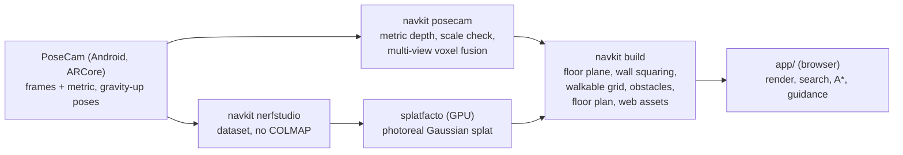

# Namma Space — indoor navigation on a phone-captured 3D map

[](https://github.com/atharv-namdeo/3d-mapping/actions/workflows/ci.yml)
[](https://atharv-namdeo.github.io/3d-mapping/app/)
[](LICENSE)

IIT Bombay Techfest 2026–27 · Intelligent Spatial Engine Challenge.

Walk through a building captured with a phone, click a room or search for a place, and follow a
walking route that stays on the real floor and goes around walls and furniture. It runs in the
browser with nothing to install.

| | |
|---|---|
| **Live app** | https://atharv-namdeo.github.io/3d-mapping/app/ |
| **Demo video** (3 min 15 s) | [assets/videos/namma_space_round2_demo.mp4](assets/videos/namma_space_round2_demo.mp4) |
| **How it works, what was measured, known limits** | [docs/ROUND2.md](docs/ROUND2.md) |
| **Capture procedure** | [docs/CAPTURE_SOP.md](docs/CAPTURE_SOP.md) |

## What it does

| Requirement | Implementation |
|---|---|
| Click rooms or zones to reveal their names | Labels for objects, floor polygons for rooms. Clicking a label, anywhere inside a zone, or any floor spot opens a card with the name, category, containing room and walking distance. Labels hidden behind walls are dimmed and decluttered. |
| Spatial search with instant transition | Typo-tolerant search (Damerau–Levenshtein), aliases ("stairs" → Staircase), category words and "nearest …" queries, ranked by **walking** distance. `Enter` routes, `Shift+Enter` jumps there. Deep links: `?scene=hostel&poi=lifts`. |
| Obstacle-aware routes on the walkable floor | A* over a 5 cm walkability grid with body clearance (0.22 m, or 0.38 m step-free), smoothed by line-of-sight shortcuts and rounded corners. Turn-by-turn guidance names nearby landmarks, re-routes when you leave the path, and orders multi-stop trips. |
| Free first-person roaming | `W A S D` + mouse; collisions slide along walls. Touch: left thumb walks, right thumb looks. |
| Tagging a new venue | Press `E`: click to add a place, draw a room polygon, export `pois.json`. |

## Measured

| Check | Result |
|---|---|
| Walkable mask vs. exact ground truth (synthetic office) | 0.01 % of walkable cells are actually solid; IoU 0.89 |
| Routes keep body clearance | every route sampled every 2 cm in the tests, for every place in every shipped scene |
| Route length | within 5 % of the exact 8-connected shortest path |
| Planning time | 1–2 ms (home), ~35 ms for a 24 m route on a 347 × 504 grid |
| Hostel photoreal splat, 137 held-out frames | PSNR 24.5 dB, SSIM 0.85, LPIPS 0.25; median 4.3 cm from the fused geometry |

## Run it

```bash
git clone --depth 1 https://github.com/atharv-namdeo/3d-mapping.git
```

```bash
cd 3d-mapping && python3 -m http.server 8080
```

Open http://localhost:8080/app/. There is no build step; any static server works.

```bash
npm test
```

```bash
pip install -r navkit/requirements.txt && npm run test:pipeline
```

The first runs the JavaScript tests (grid, planner, search, spatial index, guidance, shipped scenes)
with no dependencies. The second runs the pipeline against ground truth. CI runs both on every push.

## Pipeline



Build the hostel from a PoseCam session (CPU only):

```bash
python -m navkit posecam path/to/posecam-session app/scenes/hostel --stride 4
```

```bash
python -m navkit build app/scenes/hostel
```

Train the photoreal splat on an NVIDIA GPU: [docs/TRAIN_SPLAT_LOCAL.md](docs/TRAIN_SPLAT_LOCAL.md)
(`python scripts/train_splat_local.py --quality high`), or the
[Kaggle](notebooks/train_hostel_splat_kaggle.ipynb) / [Colab](notebooks/train_hostel_splat_colab.ipynb) notebooks.

Add another space: create `app/scenes/<id>/scene.json` pointing at a splat `.ply` or point cloud, run
`python -m navkit build app/scenes/<id>`, add it to `app/scenes/index.json`, then tag places in the browser with `E`.

## Scenes

| Scene | Source |
|---|---|
| **Hostel** | Our own capture: one 4-minute PoseCam walk, 1,376 frames, 179 m² of walkable floor, 16 places and zones. Photoreal splat trained from the PoseCam frames and poses. |
| **Home** | A Gaussian-splat scene from a teammate's training workspace; scale estimated (about ±10 %). |
| **Office** | Synthetic, 24 × 16 m, built from a known layout to measure accuracy. Labelled as synthetic in the app. |

## Repository

```
app/            web app (ES modules, no bundler)
  src/core/       grid, A*, spatial index, search, guidance (no DOM, unit-tested)
  src/view/       three.js viewer, player, route visual, labels, minimap
  src/ui/         search box, cards, POI editor
  scenes/         per-scene data: nav.json, pois.json, splat / points, floor plan
navkit/         Python: capture -> walkable grid, floor plan, web assets
scripts/        splat training, demo recording, data fetch
tests/          JavaScript and Python tests (run by .github/workflows/ci.yml)
docs/           Round 2 write-up, capture SOP, training guide; docs/round1/ = Round 1 documents
datasets/       hostel training data and the trained splat
submission/     Round 2 submission document
monomap/        Round 1 pipeline and the PoseCam Android app (monomap/android/PoseCam)
index.html      project landing page (Round 1 overview, links to the app)
```

## Third-party software

three.js r167 (MIT) and GaussianSplats3D 0.4.7 by Mark Kellogg (MIT), vendored in `app/vendor/`
with their licences. Depth Anything V2 Metric-Indoor-Small (Apache-2.0) for depth; Nerfstudio
splatfacto (Apache-2.0) for splat training; Google ARCore in PoseCam. numpy, scipy and Pillow at
build time. Some home-scene assets come from the team repository
[BENi-Aditya/Namma-Space](https://github.com/BENi-Aditya/Namma-Space).

## Team

Namma Space team, IIT Bombay Techfest 2026–27. Lead developer: [@atharv-namdeo](https://github.com/atharv-namdeo).

Released under the [MIT licence](LICENSE).
