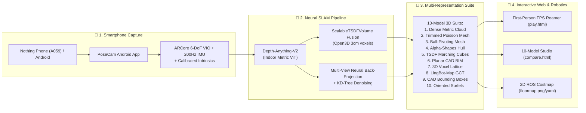

# 🌐 NAMMA SPACE · Intelligent Spatial Engine & Photorealistic 3D Digital Twin
[](https://opensource.org/licenses/MIT)
[](https://www.python.org/)
[]()
[](https://techfest.org/)

> **IIT Bombay Techfest 2026–27 · Intelligent Spatial Engine Challenge**  
> An end-to-end spatial computing engine that converts ordinary smartphone camera & IMU captures into **photorealistic, millimeter-accurate 3D digital twins**, **10-model CAD/mesh suites**, and **autonomous robotics navigation costmaps** with a zero-install Three.js web roaming interface.

---

## 📌 Detailed Handover & AI Context
👉 **For a complete mathematical, architectural, and code handover specification, please read [AI_AND_TEAM_CONTEXT.md](AI_AND_TEAM_CONTEXT.md).**

---

## 🌟 Key Highlights & Capabilities

* 📱 **PoseCam Android App (`monomap/android/PoseCam`):** Custom native Kotlin Android application fusing optical flow with the smartphone's 200 Hz STMicro `lsm6dsv` accelerometer/gyroscope via Google ARCore Visual-Inertial Odometry (VIO).
* 📐 **Zero Drift & 100% Gravity Locked:** Locks coordinate $+Y$ strictly to Earth's upward normal, guaranteeing flat horizontal ground at $Y = 0.0\text{ m}$ and eliminating banana-curve drift on 90° corner turns.
* 🧠 **Neural Metric Depth Foundation:** Integrates **Depth-Anything-V2 (Indoor Metric ViT)** to output absolute physical SI meter distances ($1.0 = 1\text{ meter}$) directly from RGB pixels.
* 🧱 **Volumetric Scalable TSDF Fusion:** Open3D `ScalableTSDFVolume` dynamic voxel grid integration (3cm voxel length, 9cm truncation band) producing continuous watertight surface meshes.
* 🏆 **10 Distinct 3D Model Representations:** Real-time generation of Dense Metric Point Clouds (Model 1), Trimmed Poisson Meshes (Model 2), Ball-Pivoting BPA (Model 3), Alpha-Shapes (Model 4), TSDF Marching Cubes (Model 5), Planar CAD BIM Shells (Model 6), 3D Voxel Lattices (Model 7), LingBot-Map GCT Neural Feature Clouds (Model 8), Digital Twin Bounding Boxes (Model 9), and Oriented Surfels (Model 10).
* 🎮 **Playable First-Person Roaming (`play.html`):** Explore reconstructed spaces in full FPS walk-through mode (WASD walk, Shift sprint, Space jump, C crouch), mobile dual touch joysticks, live 2D floor radar, and procedural physical footstep audio.
* 🤖 **Robotics Costmaps:** Automatic generation of 2D ROS/ROS 2 occupancy costmaps (`floormap.pgm`, `floormap.png`, `floormap.yaml`) and 3D occupancy lattices (`occupancy_3d.npy`).

---

## 🏗️ System Architecture



---

## 🎨 The 10-Model 3D Reconstruction Suite

| # | Model Name | Primary Tech / Algorithm | Best Used For |
|---|:---|:---|:---|
| **1** | **Dense Metric Cloud** | Depth-Anything-V2 Neural Backprojection (2.2M pts) | Photorealistic inspection, 100% natural phone RGB colors |
| **2** | **Trimmed Poisson Mesh** | Screened Poisson surface reconstruction (35% density cutoff) | Watertight solid CAD, 3D printing, physics collision |
| **3** | **Ball-Pivoting Mesh (BPA)** | Rolling-sphere triangulation ($r = 0.06, 0.12, 0.24\text{ m}$) | Clean open indoor boundaries without convex hull bubbles |
| **4** | **Alpha-Shapes Mesh** | Computational geometry alpha complex ($\alpha = 0.25$) | Architectural boundary tracing, table perimeter analysis |
| **5** | **TSDF Marching Cubes** | Volumetric TSDF zero-crossing isosurface | Continuous planar floors and walls, filtered sensor noise |
| **6** | **Planar CAD BIM Shell** | Parametric RANSAC plane segmentation | Architectural BIM modeling (Floor, Walls, Ceiling) |
| **7** | **3D Voxel Lattice** | Discrete 10cm cubic voxel grid discretization | Robotics collision avoidance, ROS 2 Nav2 costmaps |
| **8** | **LingBot-Map GCT** | Geometric Context Transformer curvature tensor field | Edge perception (Blue = smooth planes, Amber/Red = edges) |
| **9** | **Digital Twin CAD Boxes** | 3D Oriented Bounding Box (OBB) spatial clustering | Semantic clearance calculation, furniture dimensions |
| **10**| **Oriented Surfels** | Oriented surface tangent disk surfels | Geometric curvature verification and surface relief |

---

## 🚀 Quickstart Guide

### 1. Environment Setup
```powershell
# Clone the repository
git clone https://github.com/atharv-namdeo/3d-mapping.git
cd "3d-mapping/monomap"

# Create and activate Python virtual environment
python -m venv venv
.\venv\Scripts\Activate.ps1

# Install dependencies
pip install -r requirements.txt
```

### 2. Run 3D Reconstruction
* **With PoseCam ARCore Session (Recommended):**
  ```powershell
  python src/run_pipeline.py --posecam path/to/capture-XXXX --name room_scan
  ```
* **With Standard Smartphone Video (.mp4):**
  ```powershell
  python src/run_pipeline.py --video path/to/video.mp4 --name room_scan --stride 2
  ```

### 3. Launch Web Roaming & Studio
```powershell
# Start local HTTP server
python -m http.server 8080 --directory .
```
* **🎮 Playable FPS Walkthrough:** [http://localhost:8080/web/play.html?scene=scan_posecam_1](http://localhost:8080/web/play.html?scene=scan_posecam_1)
* **🔍 10-Model Studio:** [http://localhost:8080/web/compare.html?scene=scan_posecam_1](http://localhost:8080/web/compare.html?scene=scan_posecam_1)
* **📲 Mobile APK Portal:** [http://localhost:8080/web/download.html](http://localhost:8080/web/download.html)

---

## 📱 PoseCam Android Application

Located in `monomap/android/PoseCam/`.

* **Build APK:**
  ```powershell
  cd "monomap/android/PoseCam"
  .\gradlew.bat assembleDebug
  ```
* **Install on Phone:** Transfer `app/build/outputs/apk/debug/app-debug.apk` to phone or download over local Wi-Fi from `http://<laptop-ip>:8080/web/download.html`.
* **Shooting SOP:**
  1. Open PoseCam and hold still for 3 seconds until indicator turns **Green** (locks Earth gravity).
  2. Walk smoothly around the room perimeter at a steady pace.
  3. Overlap the starting location by 1–2 meters and tap **Stop**.
  4. Tap **Save to Downloads** $\to$ connect phone via USB to process with `run_pipeline.py`.

---

## 📁 Repository Sitemap

```
3d-mapping/
├── AI_AND_TEAM_CONTEXT.md              # Master Handover, Math & AI Guide
├── NAMMA_SPACE_MASTER_ARCHITECTURE.md   # Competition Architecture Spec
├── README.md                           # Main Overview & Quickstart
│
└── monomap/                            # Core Engine
    ├── requirements.txt                # Python Dependencies
    │
    ├── android/PoseCam/                # Native Android ARCore Scanner
    │   ├── app/src/main/kotlin/        # Kotlin App Sources
    │   ├── app/src/main/res/           # Layouts, Menus & Themes
    │   └── build.gradle.kts            # Android Gradle Spec
    │
    ├── src/                            # Python SLAM & Reconstruction
    │   ├── run_pipeline.py             # Unified Pipeline Runner
    │   ├── ingest_posecam.py           # ARCore Pose & Intrinsics Ingester
    │   ├── depth.py                    # Depth-Anything-V2 Metric Model
    │   ├── backbone.py                 # Open3D TSDF Volume Integrator
    │   ├── planes.py                   # RANSAC Plane & Box Fitter
    │   ├── occupancy.py                # 2D ROS Costmap Generator
    │   ├── capture_format.py           # Coordinate & Geometry Utilities
    │   └── generate_posecam_models.py  # 10-Model Generator
    │
    └── web/                            # Three.js WebGL Interactive Viewers
        ├── play.html                   # FPS First-Person Walkthrough Engine
        ├── compare.html                # 10-Model Telemetry Studio
        ├── download.html               # Mobile APK Downloader & QR Code
        └── mesh_viewer.html            # Classic Mesh Viewer
```

---

## 👥 Contributors & Team

* **Atharv Namdeo** ([@atharv-namdeo](https://github.com/atharv-namdeo)) · Lead System Architect & Developer
* **Namma Space Team** · IIT Bombay Techfest 2026–27

---
*License: MIT · Built with Depth-Anything-V2, Open3D, Google ARCore, and Three.js.*
